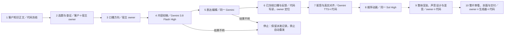
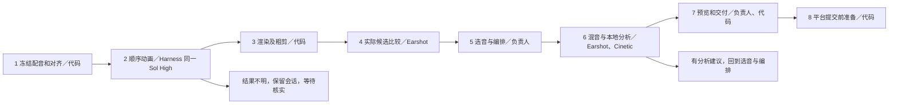

# 执行图与来源

本版保留原职责。迁入范围到文字，另外独立验证本地 MP4 技术检查；下图虚线后的制作、交付及对应模型适配仍待迁入。

| 阶段 | 当前来源与实际依赖 | 产品实现及证据 |
| --- | --- | --- |
| 选题、能力与研究 | `docs/CONTENT_PRODUCTION.md`、`docs/runbooks/{topic-planning,topic-research}.md`；原 owner 使用可用浏览与客户能力正文查证 | 本地冻结工作单，owner 提交经查证正文；不声称程序验证语义、网站或宿主模型身份。 |
| 方向、初稿、表达编辑 | 原 owner 选定业务切面；`config/{active-providers,provider-profiles}.json` 的 Gemini 官方兼容端点；`src/runtime/narration-human-writing.ts` 冻结四份技能原文 | 同一官方模型及 High，两次请求分别绑定输入；记录模型、响应 ID、SHA。表达方法含 MIT 许可原文，保留初稿。无真实调用证据时不宣称真实生成。 |
| 配音、对齐 | Gemini 3.8 Flash TTS / Zubenelgenubi / 原速；FFmpeg；`src/runtime/python/audio_caption_alignment.py` 与原真实音轨对齐合同 | 停在待配音。保留工作单和最终口播；待迁入客户配音配置、真实对齐、回执恢复。 |
| 顺序动画 | `scene-project-authoring.ts`，同一 Sol High、当前段 ≤30 秒、完整音轨/口播/对齐与本 run SDK、实际 Codex spawn/followup 回执；Remotion 4.0.532 | WorkBuddy 未证实同模型、同作者续派与真实调用证据。不得以宿主默认模型代替。 |
| 音乐、声音、渲染 | 本地授权选曲库；Earshot 实际候选、CLAP 分析与 Cinetic 混音；FFmpeg / Remotion；owner 判断编排、修正遮蔽、整片审看 | 无素材随包。仅迁入音视频流校验思想并实现 FFmpeg/ffprobe 技术诊断；后续须接原生声音工具、完整制作及审看。 |
| 封面、交付 | owner 与登记图像工具；原平台账号、防重提交与 Hermes 归档 | 待接客户生成器及账号；提交与公开可见分开，不自动上传。 |
| 知识反馈 | `src/runtime/project-knowledge.ts`：快照、上下文和反馈读回；原连接器读写 Notion | 保留版本绑定与回读语义，采用客户工作区 Markdown 节点及同节点反馈记录；未迁入 Notion 专用 ID、授权或同步。 |

来源：`docs/source-baseline.json` 登记的 04b1d3a42fa3c67c9304cda9af813c15fe847646，来源工作树干净，登记的十项 SHA 均一致。核心按上述合同重新实现，未引入原 monolith 或个人配置。FFmpeg 音视频双流守卫取自 `direct-run.ts` 的 `assertAudioVideoStreams`；其余为产品适配。MIT 方法文件来自来源运行时所登记的本机 human-writing，见旁附 LICENSE。

WorkBuddy 入口依据[官方技能格式](https://open.workbuddy.cn/docs/skill)的 YAML、scripts 和 references；当前不需要声明远程连接器。客户选择工作区与安装位置，程序不访问来源项目、宿主私有目录或宿主账号。

DeepSeek Harness 使用工作区的 `.dsh/skills/ai-production-studio`，脚本入口与 WorkBuddy 共用。本机用 `dsh 0.1.1-rc.2` 的 headless profile、隔离状态目录和仅回环的模型夹具，实测宿主发现技能、读取技能正文并通过 `pwsh` 执行解包后的脚本。测试从客户正文走到五阶段记录、口播导出、反馈读回和新任务消费采纳要求，停在 `needs_tts`。证据在本地 `.local/dsh-smoke-receipt.json`。这次验证覆盖宿主工具和离线工作流，真实模型和桌面交互待实测。[DeepSeek Harness 技能文档](https://github.com/deepseek-ai/deepseek-harness/blob/master/docs/subsystems/skills.md)

0.1.1 增加本地 stdio MCP。连接从启动参数绑定一个已初始化的 Obsidian 仓库，工具复用原工作单、SHA 和反馈校验。已在桌面版 `0.2.1-rc.2` 自带的 headless 运行时接入解包后的 MCP，用虚构客户分别启动两次 Harness。第二次用相同 run ID 从研究续跑，导出口播并两次提交同一反馈，核对 Markdown 后再从新任务工作单读到已采纳要求。该次使用本地模型夹具，证据在 `.local/dsh-mcp-acceptance/receipt.json`。[DeepSeek Harness MCP 客户端](https://github.com/deepseek-ai/deepseek-harness/blob/master/packages/mcp/mcp-client/README.md)

2026-11-05 本地开发版增加按任务授权的 MCP 工具。用虚构青屿仓储通过同一 Harness 实测，Harness 调度使用回环夹具，两次 `gemini-3.8-flash` 文字请求和一次 `gemini-3.8-flash-tts` 配音均由 Google 正式 API 返回。三次请求分别保存回执，WAV 绑定最终润色稿 SHA。FFmpeg 完整解码通过，音频为 22.96 秒、24 kHz 单声道 PCM。此次是短配音测试，字幕对齐和正式生产状态推进未执行。证据在 `.local/dsh-gemini-live/receipt.json`。[Gemini 配音模型](https://ai.google.dev/gemini-api/docs/models/gemini-3.8-flash-tts)

0.2.0 在独立工作区接上本地后期和交付。沿同一个虚构客户 run 复用真实 Gemini 润色稿和配音，桌面版 Harness 内置运行时通过 stdio MCP 完成 10 条 Whisper 字幕、三个按时长登记的技术样片段、粗剪、独立提示音混音及预览。第二个 Harness 进程沿原 ID 从审看续跑，导出与当前已接受预览同 SHA 的成片、封面和说明，并回写 Obsidian。技术审核涵盖完整解码和三个段落抽帧，验收范围为 `technical_validation`。证据在 `.local/full-video-harness/receipt.json`。

本机对齐脚本源于视频平台基线的 `src/runtime/python/audio_caption_alignment.py`，原文件 SHA256 为 `3b1ba2c8edfaefb068defc3a8e22a40c06e4ad8f9b44b51b3f19b54df3550ac9`。迁入后增加本机权重参数和 CPU 执行，保留对齐算法。后期适配接收创作者交件，并执行同一时间轴的 FFmpeg 合成。

最新本地开发使用 DeepSeek Harness ACP 作为动画作者宿主。新段按原会话续接，当前适配面为结构化二维画面数据，Pillow/FFmpeg 本地渲染。原 Remotion 创作面不在本适配中。泊岸仓储真跑两次 Gemini 文字、一次 TTS 与 11 条 Whisper 对齐后，真实 Harness 会话确认 Sol High 并多次调用技能，超时前没有返回画面。生产工作单保留该会话和不重发标记。代码已对专用作者会话禁用技能和通用工具，协议测试验证同会话续接。独立的 Codex 派发记录不用于 Harness 验收。

原 `earshot_sound.py`、动画创作指导、Earshot/Cinetic 文件清单及上传器源码从登记基线迁入。上传器仅调整客户状态目录和帮助参数格式。用青屿仓储已验样片独立测试，Earshot 渲染并比较三个候选，Cinetic 原生混音实际达到 -14.07 LUFS、-1.34 dBTP。后续分析仍要求调整音乐覆盖、立体声和低频，声音结果尚未放行。用原技术样片独立验证抖音和 B 站的提交前准备，检查了上传器帮助、横竖封面和 689 帧像素一致性，停在账号检查前。回执在 `.local/original-pipeline-live/`。[Harness ACP 入口](https://github.com/deepseek-ai/deepseek-harness/blob/master/packages/acp/acp/README.md)
